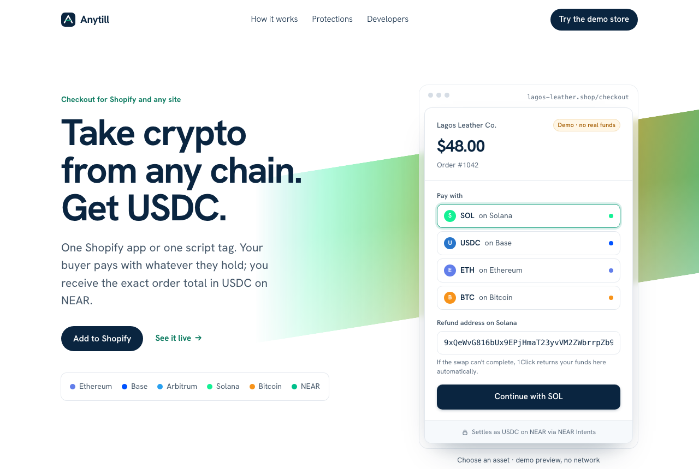
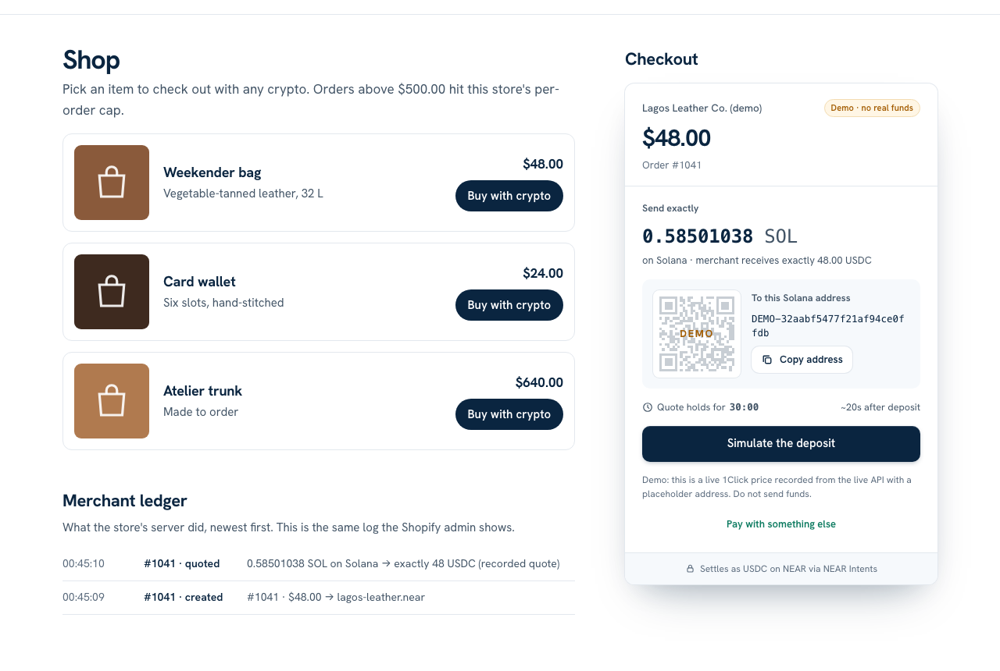

# Anytill

**Take crypto from any chain. Get USDC on NEAR.**

Anytill is a Shopify app and a one-script-tag checkout widget. A buyer pays with whatever they hold (USDC on Base, ETH on Arbitrum, SOL, BTC, NEAR and more); the store receives the **exact** order total as USDC in its own NEAR account, through NEAR Intents 1Click. The order is marked paid only after the server has verified the settlement on NEAR.

**The problem.** A store that wants crypto today either picks one chain and loses everyone else, or uses a custodial processor. Shopify's payments-app route takes weeks of approval. And cross-chain checkouts fail quietly: short deposits, swapped recipients, a page that says "paid" when nothing arrived.



## Live in your Shopify store in 60 seconds
1. Install the app on your store (see [Install on a real store](#install-on-a-real-store); it is not on the App Store yet).
2. Paste your NEAR account. Anytill checks that it exists and can hold USDC.
3. Create the manual payment method **Pay with any crypto** and add the **Anytill pay** block to the Thank-you and Order-status pages. Done.

Buyers pick "Pay with any crypto" at checkout, then pay from the Thank-you page. When USDC lands and is verified, the order flips to **Paid** in Shopify (`orderMarkAsPaid`), tagged `anytill-paid`, with the NEAR transaction stored in an `anytill.settlement` metafield.

## Try it now, no keys (demo mode)

Needs Node 22.12+. Yarn 4 is committed in `.yarn/releases`, so either enable it with corepack or call it with node:

```bash
git clone <this repo> anytill && cd anytill
corepack enable      # puts `yarn` on PATH (Node ships corepack); skip if you already have yarn
yarn install
yarn demo            # builds, migrates SQLite, serves http://localhost:3000
```

No corepack? Use the committed binary: replace `yarn` with `node .yarn/releases/yarn-4.18.1.cjs`, e.g. `node .yarn/releases/yarn-4.18.1.cjs install && node .yarn/releases/yarn-4.18.1.cjs demo`.

The first install downloads Prisma's engines (~30 MB) and the test run downloads Chromium; on a slow connection that takes a few minutes.

| Do this | You see this |
|---|---|
| Open `http://localhost:3000` and scroll | The checkout card on the right moves through choose → quote → settling → paid |
| Open `/demo`, click **Buy with crypto** on the Weekender bag ($48) | The widget for order #10xx, with eleven assets on six chains |
| Pick **SOL**, paste any Solana address as the refund address, **Continue** | A live 1Click `EXACT_OUTPUT` price (dry run): about 0.577 SOL for exactly 48 USDC, a placeholder `DEMO-…` address and a 30-minute timer |
| Click **Simulate the deposit** | Steps tick through deposit → swap → verify; then "Paid · Settled in N s" and "8 of 8 server-side checks passed" |
| Look at **Merchant ledger** under the products | Each server step: created, quoted, deposit seen, verified (8/8), marked paid |
| Click **Buy with crypto** on the $640 Atelier trunk | Refused: above the store's $500 per-order cap, no quote issued |
| Open `/app` | The merchant admin (Polaris) for the demo store: payout account, caps, payments, refunds, proof timeline |




Demo mode is labelled on every screen. Prices are real (1Click `dry: true`, or quotes recorded from the live API when offline); the deposit address is a placeholder and the deposit is simulated. No funds move.

## Not on Shopify? One script tag

```html
<script type="module" src="https://<your-anytill-host>/widget/anytill.js"
        data-merchant="you.near" data-amount="48.00" data-order-ref="A-1001"></script>
```

Or place the element yourself:

```html
<intents-checkout merchant="you.near" amount="48.00" order-ref="A-1001"></intents-checkout>
<style>
  intents-checkout { --anytill-accent: #0F9D7A; --anytill-radius: 10px; --anytill-font: inherit; }
</style>
```

`<intents-checkout>` is a [Lit](https://lit.dev) web component in Shadow DOM: no framework, no style leaks, about 22 KB gzipped. It inherits the page's font and takes colours through CSS variables. It fires `anytill:status` events (`{ status, paymentId }`). Confirm payment on your server with `GET /api/v1/payments/:id` (status `paid`), never from the browser event alone.

## What happens when a buyer pays

| Step | Who | Proof |
|---|---|---|
| 1. Order total read | Anytill server, from the Shopify Admin API | The browser never sends a price |
| 2. Caps checked | Anytill server | Per-order cap and rolling 24-hour cap per store |
| 3. Quote | NEAR Intents 1Click, `swapType: EXACT_OUTPUT`, recipient = merchant's NEAR account, destination = USDC on NEAR | Quote signature and deposit address stored with the order |
| 4. Deposit | Buyer, by QR or from a connected EVM wallet (Aurora Intents Connect transfer) | Origin-chain tx |
| 5. Swap and payout | 1Click solvers through the NEAR Intents verifier | USDC transferred to the merchant on NEAR |
| 6. Verify | Anytill server | 1Click status must match the stored quote (status, signature, deposit address, recipient, asset, EXACT_OUTPUT amount, delivered amount) **and** the NEAR receipt must show a NEP-141 `ft_transfer` of USDC to the merchant |
| 7. Re-check order | Anytill server | Order not cancelled, still owes the quoted amount; otherwise **needs review** |
| 8. Mark paid | Shopify Admin API `orderMarkAsPaid`, once (atomic claim) | `anytill-paid` tag, `anytill.settlement` metafield with the NEAR tx |

If the buyer sends too little or too late, 1Click refunds them at the refund address they gave before quoting; any overpayment above the quote is refunded too. For a return, the admin's **Refund in crypto** builds a 1Click quote from the merchant's USDC back to the buyer's original asset and address, and shows the one `near` CLI command to send it.

## Fees and limits

| | |
|---|---|
| Anytill fee | None. Open source, MIT |
| 1Click fee | 0.2% without a partner JWT ([partners.near-intents.org](https://partners.near-intents.org)); set `ONECLICK_JWT` to change it |
| Slippage | 1% by default, on the buyer's side. The merchant always gets the exact amount |
| Per-order cap | $500 by default, set per store |
| 24-hour cap | $5,000 by default, set per store |
| Quote validity | 30 minutes, then the buyer gets a fresh quote |
| Currency | USD orders (settled 1:1 in USDC) |
| Custody | None. USDC goes from the NEAR Intents verifier straight to the merchant's account. Anytill holds no keys and no funds |

## For developers

`yarn && yarn dev` · `yarn test` → unit tests, then a full checkout E2E (desktop and 375 px mobile) against recorded 1Click quotes.

```bash
corepack enable      # or use node .yarn/releases/yarn-4.18.1.cjs in place of yarn
yarn install
yarn test            # 20 unit tests + Playwright E2E; offline and deterministic
yarn test:live-dry   # one extra test against the live 1Click API (dry: true, no funds)
yarn screenshots     # regenerates docs/screens/*.png
```

```
app/routes/           React Router routes: landing, /demo, /pay/:id, /app (admin), /api/v1/*, /api/checkout/session
app/lib/              settlement.server.ts (the checks), payments.server.ts (caps, quotes, polling, mark-paid, refunds),
                      oneclick.server.ts (1Click client), near.server.ts (NEAR RPC), orders.server.ts (Shopify Admin)
extensions/checkout-widget/   Shopify checkout UI extension (Thank-you + Order-status block)
widget/               <intents-checkout> Lit web component → public/widget/anytill.js
prisma/               SQLite schema and migration
tests/                Playwright: unit/ (no browser) and e2e/
render.yaml           Render Blueprint (Node web service + disk)
```

**NEAR technology used**
- **NEAR Intents 1Click API**: `POST /v0/quote` with `EXACT_OUTPUT`, `GET /v0/status`, `POST /v0/deposit/submit`. Settlement runs through the NEAR Intents verifier into the merchant's account; there is no Anytill contract.
- **NEAR RPC** (`EXPERIMENTAL_tx_status`, `view_account`, `storage_balance_of` on the USDC contract `17208628…36133a1`): reads the payout receipt and checks the merchant account.
- **Aurora Intents Connect** (`@aurora-is-near/intents-connect-wallet/evm`): sends the deposit from an injected EVM wallet (Ethereum, Base, Arbitrum). Every other chain pays by QR / address.
- **USDC on NEAR** (NEP-141) as the settlement asset.

**Stack**: Shopify's React Router app template (React Router 7.18.2, the version the template pins; see FAQ), Polaris web components in the admin, Prisma + SQLite, Node, Lit 3 for the widget, yarn 4, Playwright, Render.

### Install on a real store
You need a Shopify Partner account, a development or real store, a NEAR mainnet account registered with the USDC contract, and somewhere to host the app.

1. `cp .env.example .env`, set `ANYTILL_MODE=live`, `SHOPIFY_APP_URL`, and later the Shopify keys.
2. Deploy with `render.yaml` (Render → New → Blueprint), or any Node host with a persistent disk.
3. `shopify app config link` (creates the app in your Partner account and fills `client_id`), put the client id and secret into the host's env, update `application_url` and `redirect_urls` in `shopify.app.toml`, then `shopify app deploy` to ship the config and the checkout extension.
4. Install the app on your store from the Partner Dashboard, open it, paste your NEAR account, set caps, turn it on.
5. In the checkout editor, add **Anytill pay** to the Thank-you and Order-status pages and set its **Anytill app URL** setting.

## What is real and what is demo

| Part | Status |
|---|---|
| 1Click quotes | Real API. Demo uses `dry: true` (real prices, no deposit address); tests use responses recorded from the live API on 2026-11-10 |
| Settlement verification | Real code, unit-tested against tampered statuses and receipts. In demo it runs on a simulated NEAR receipt, labelled as such |
| Deposit and swap | Live mode: real. Demo: simulated, placeholder `DEMO-…` address, QR crossed out |
| Shopify | Admin API calls are real code; they need a store to run. Demo `/app` shows the seeded demo store outside Shopify |
| Mainnet usage | None yet. No real orders have been paid through Anytill at the time of writing |

## FAQ

**Why not a Shopify payments app?** Payments-app approval takes weeks and is limited to approved partners. A manual payment method plus `orderMarkAsPaid` works on any store today.

**Why React Router 7 and not 8?** `@shopify/shopify-app-react-router` (4.0.2) declares `react-router ^7.6.2` as a peer, and Shopify's template pins 7.18.2 (7.18.3 broke action-origin checks behind proxies). Anytill follows the template.

**Can a buyer fake a payment?** The browser only shows status. Orders are marked paid by the server after it checks 1Click's status against the quote it issued and reads the USDC transfer from NEAR.

**What if the NEAR RPC is down?** Verification fails closed: the payment stays in "verifying" and the poller retries. It is never marked paid on 1Click's word alone.

**What if the order changes after the quote?** The server re-reads the order before marking it paid. If the total changed or it was cancelled, the payment goes to **needs review** and the merchant can refund in crypto.

**Which assets?** USDC (Base, Arbitrum, Ethereum, Solana), USDT (Ethereum), ETH (Ethereum, Base, Arbitrum), SOL, BTC, NEAR. Some routes have minimums set by 1Click; the buyer sees them as a plain message. BTC takes longer to settle (1Click estimates ~13 min).

## Credits and licence
Built during NEAR HACKATHON (2026-11). Starts from Shopify's public [React Router app template](https://github.com/Shopify/shopify-app-template-react-router) (commit `81eb98b`, MIT). Uses Lit, uqr, Prisma, Playwright and the packages listed in `package.json`. Code was written with AI assistance (Claude Code). MIT licence, see [LICENSE](LICENSE).
