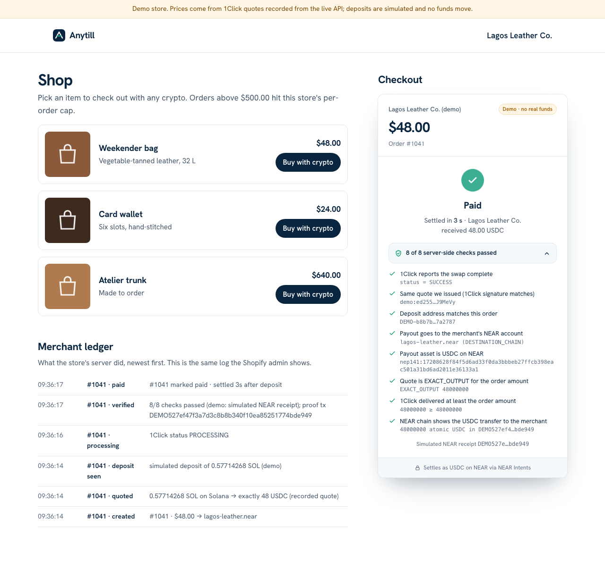
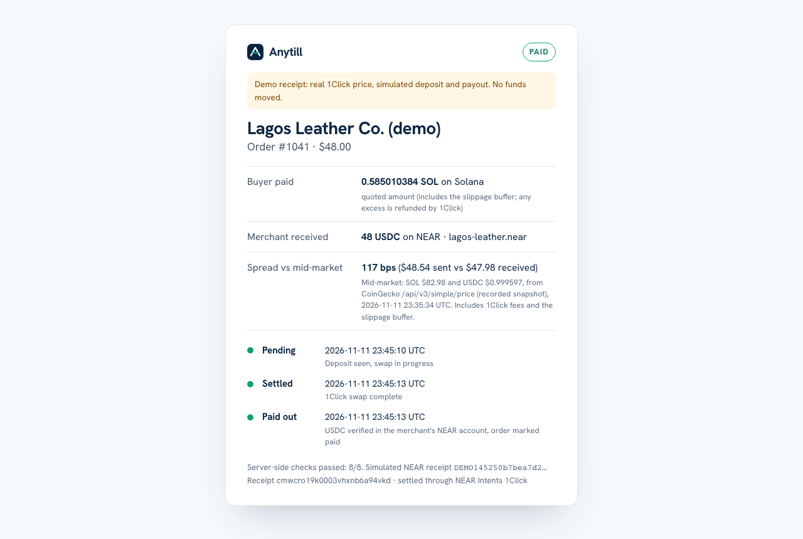

# Anytill

**Take crypto from any chain. Get USDC on NEAR.**

Anytill is a Shopify app and a one-script-tag checkout widget. A buyer pays with whatever they hold (USDC on Base, ETH on Arbitrum, SOL, BTC, NEAR and more); the store receives the **exact** order total as USDC in its own NEAR account, through NEAR Intents 1Click. The order is marked paid only after the server has verified the settlement on NEAR.

**The problem.** A store that wants crypto today either picks one chain and loses everyone else, or uses a custodial processor. Shopify's payments-app route takes weeks of approval. And cross-chain checkouts fail quietly: short deposits, swapped recipients, a page that says "paid" when nothing arrived.

**Live demo:** [anytill.vercel.app](https://anytill.vercel.app) (demo mode, no keys: open [`/demo`](https://anytill.vercel.app/demo) and buy something). **Video:** [docs/demo.mp4](docs/demo.mp4), captions in [docs/captions.srt](docs/captions.srt).

## Judge path (5 minutes, no keys)
1. `corepack enable && yarn install && yarn test` (Node 25+ no longer bundles corepack: run `npm i -g corepack` first, or use `node .yarn/releases/yarn-4.18.1.cjs` wherever this README says `yarn`): 28 unit tests and 13 browser/E2E tests, including **"Try to break it: 13 of 13 attacks refused"** and an AI agent paying over MCP.
2. `node scripts/verify-receipt.mjs docs/anchored-receipts/cmweunu3p0001vhtvemajz1gc.json` → `MATCH`: the receipt's SHA-256, recomputed on your machine, equals the hash anchored on NEAR testnet. Edit one character in the file and run it again → `MISMATCH`. No keys needed.
3. `yarn demo`, then open `http://localhost:3000/demo`, buy the $48 Weekender bag with SOL, click **Simulate the deposit**: you see Pending → Settled → Paid out with timestamps, and "8 of 8 server-side checks passed".
4. Click **View receipt**: what the buyer paid, what the merchant got in USDC, and the spread in basis points against CoinGecko's mid-market price, with the source and time printed.
5. Open `/app`: the merchant admin with money state and receipt per order.
6. Read [What is real vs simulated](#what-is-real-vs-simulated) before trusting any number.


## Live in your Shopify store in 60 seconds
1. Install the app on your store (see [Install on a real store](#install-on-a-real-store); it is not on the App Store yet).
2. Paste your NEAR account. Anytill checks that it exists and can hold USDC.
3. Create the manual payment method **Pay with any crypto** and add the **Anytill pay** block to the Thank-you and Order-status pages. Done.

Buyers pick "Pay with any crypto" at checkout, then pay from the Thank-you page. When USDC lands and is verified, the order flips to **Paid** in Shopify (`orderMarkAsPaid`), tagged `anytill-paid`, with the NEAR transaction stored in an `anytill.settlement` metafield.

## Live proof on NEAR testnet

Every receipt Anytill verifies is hashed (SHA-256 of a canonical JSON form, [`app/lib/receipt-canonical.mjs`](app/lib/receipt-canonical.mjs)) and anchored in a small write-once contract, so anyone can prove a receipt was not edited later: not by the merchant, the buyer or Anytill.

| | |
|---|---|
| Contract | [`receipts.anytill-hk1113.testnet`](https://testnet.nearblocks.io/address/receipts.anytill-hk1113.testnet) ([`contract/src/lib.rs`](contract/src/lib.rs), Rust, near-sdk 5.30, 4 unit tests) |
| Deployed | one transaction (create account, fund, add key, deploy, `new`): [BP57tB9V…](https://testnet.nearblocks.io/txns/BP57tB9VuMaNgfneef47jiSX3GX2eTssLW5v9RSKAoLb) |
| Rules | only the owner `anytill-hk1113.testnet` can anchor; an anchor can never be overwritten; `get_anchor` and `verify` are free view calls |
| Signer | [`app/lib/near-tx.mjs`](app/lib/near-tx.mjs): borsh + ed25519 from `node:crypto`, no NEAR SDK. The key is read from the NEAR CLI keychain or an env var at runtime, never from the repo |

Four demo checkouts, each priced by a **live** 1Click `dry: true` quote and valued against **live** CoinGecko prices, then settled in demo mode, verified (8/8) and anchored automatically by the server:

| Order | Buyer paid | Spread vs mid | Receipt (JSON in repo) | Anchor tx (testnet) |
|---|---|---|---|---|
| $48.00 | 0.604595751 SOL on Solana | 122 bps | [`cmweufgfj0001vhcje7see5w8`](docs/anchored-receipts/cmweufgfj0001vhcje7see5w8.json) | [9DetJmXDiY…](https://testnet.nearblocks.io/txns/9DetJmXDiYRhsAGaiZfW1JVpLQ1xSANmEHv51bjP4CkP) |
| $24.00 | 24.245755 USDC on Base | 102 bps | [`cmweuft8s0003vhcja27w6w4d`](docs/anchored-receipts/cmweuft8s0003vhcja27w6w4d.json) | [AmYXUCSfrh…](https://testnet.nearblocks.io/txns/AmYXUCSfrhXjoKvRetE1cQMzM775Hd7Trn2XjBBePbD8) |
| $120.00 | 0.062286907 ETH on Arbitrum | 127 bps | [`cmweunu3p0001vhtvemajz1gc`](docs/anchored-receipts/cmweunu3p0001vhtvemajz1gc.json) | [333koEP3dK…](https://testnet.nearblocks.io/txns/333koEP3dKNc9MMg19sdgdG4ofqBrGP4CtAkffgNbJUG) |
| $250.00 | 0.00365861 BTC on Bitcoin | 140 bps | [`cmweuo18b0003vhtvm8dy9a38`](docs/anchored-receipts/cmweuo18b0003vhtvm8dy9a38.json) | [7zp8jRzBCe…](https://testnet.nearblocks.io/txns/7zp8jRzBCe6NmcM651AqXTgaMSLHfZezLt9Jir2apEqd) |

These are demo receipts: the deposit and payout were simulated (see [What is real vs simulated](#what-is-real-vs-simulated)). The anchors are real testnet transactions and prove that the receipt contents were not edited after verification; they do not prove real money moved.

**Check one yourself:**
- CLI: `node scripts/verify-receipt.mjs docs/anchored-receipts/<id>.json` (exit code 0 = match)
- Browser: `/verify?id=<id>` on any Anytill server recomputes the hash in your browser and reads the anchor straight from a public NEAR RPC
- Raw: `curl https://test.rpc.fastnear.com -H 'content-type: application/json' -d '{"jsonrpc":"2.0","id":1,"method":"query","params":{"request_type":"call_function","finality":"final","account_id":"receipts.anytill-hk1113.testnet","method_name":"get_anchor","args_base64":"'$(printf '{"receipt_id":"cmweunu3p0001vhtvemajz1gc"}' | base64)'"}}'`

## What a merchant actually pays (live quote)

Live 1Click dry:true quotes for a $250.00 order (merchant receives exactly 250.00 USDC on NEAR), 2026-11-13T10:46:42.557Z.
Mid-market: CoinGecko /api/v3/simple/price, same run (USDC $0.999544, USDT $0.999243, ETH $1950.3, SOL $80.35, BTC $69264, NEAR $3.48, USDC $0.999544).

| Buyer pays with | Buyer sends (quote) | Spread at minimum input | Spread at quoted input (incl. 1% slippage buffer) | 1Click time estimate |
|---|---|---|---|---|
| USDC on Base | 252.553615 | 1 bps | 102 bps | ~35 s |
| USDT on Ethereum | 252.739747 | 5 bps | 107 bps | ~45 s |
| ETH on Arbitrum | 0.129753839750290719 | 26 bps | 127 bps | ~25 s |
| SOL on Solana | 3.148698524 | 23 bps | 125 bps | ~20 s |
| BTC on Bitcoin | 0.00365111 | 19 bps | 120 bps | ~805 s |
| NEAR on NEAR | 72.659047049210988724963591 | 18 bps | 119 bps | ~20 s |

EXACT_OUTPUT: the merchant always receives exactly the order total. The spread is what the buyer sends on top, at mid-market. "Minimum input" is the least 1Click accepts for the quote; the quoted input adds a 1% slippage buffer that 1Click refunds if unused, so the real cost lands between the two. Bitcoin is slow (~13 min). Re-run with `node scripts/merchant-quote.mjs 250`; saved output: [docs/merchant-quote-2026-11-13.md](docs/merchant-quote-2026-11-13.md).

## Try it now, no keys (demo mode)

Needs Node 22.12+. Yarn 4 is committed in `.yarn/releases`, so either enable it with corepack or call it with node:

```bash
git clone <this repo> anytill && cd anytill
corepack enable      # puts `yarn` on PATH; Node 22-24 ship corepack, on Node 25+ run `npm i -g corepack` first
yarn install
yarn demo            # builds, migrates SQLite, serves http://localhost:3000
```

No corepack? Use the committed binary: replace `yarn` with `node .yarn/releases/yarn-4.18.1.cjs`, e.g. `node .yarn/releases/yarn-4.18.1.cjs install && node .yarn/releases/yarn-4.18.1.cjs demo`.

The first install downloads Prisma's engines (~30 MB) and the test run downloads Chromium; on a slow connection that takes a few minutes.

| Do this | You see this |
|---|---|
| Open `http://localhost:3000` and scroll | The checkout card on the right moves through choose → quote → settling → paid |
| Open `/demo`, click **Buy with crypto** on the Weekender bag ($48) | The widget for order #10xx, with eleven assets on six chains |
| Pick **SOL**, paste any ordinary Solana address as the refund address, **Continue** | A live 1Click `EXACT_OUTPUT` price (dry run): the SOL amount for exactly 48 USDC at today's price (0.65 SOL on 2026-11-14), a placeholder `DEMO-…` address and a 30-minute timer |
| Click **Simulate the deposit** | Steps tick through deposit → swap → verify; then "Paid · Settled in N s" and "8 of 8 server-side checks passed" |
| Click **View receipt** | A shareable receipt at `/r/<id>`: "Buyer paid <amount> SOL on Solana; merchant received 48 USDC on NEAR; spread N bps vs mid-market (CoinGecko)", plus Pending / Settled / Paid out timestamps |
| Look at **Merchant ledger** under the products | Each server step: created, quoted, deposit seen, verified (8/8), marked paid |
| Click **Buy with crypto** on the $640 Atelier trunk | Refused: above the store's $500 per-order cap, no quote issued |
| Open `/app` | The merchant admin (Polaris) for the demo store: payout account, caps, payments, refunds, proof timeline |





Demo mode is labelled on every screen. Prices are real (1Click `dry: true`, or quotes recorded from the live API when offline); the deposit address is a placeholder and the deposit is simulated. No funds move.

## Not on Shopify? One script tag

```html
<script type="module" src="https://<your-anytill-host>/widget/anytill.js"
        data-merchant="you.near" data-amount="48.00" data-order-ref="A-1001"></script>
```

Or place the element yourself:

```html
<intents-checkout merchant="you.near" amount="48.00" order-ref="A-1001"></intents-checkout>
<style>
  intents-checkout { --anytill-accent: #0F9D7A; --anytill-radius: 10px; --anytill-font: inherit; }
</style>
```

`<intents-checkout>` is a [Lit](https://lit.dev) web component in Shadow DOM: no framework, no style leaks, about 22 KB gzipped. It inherits the page's font and takes colours through CSS variables. It fires `anytill:status` events (`{ status, paymentId }`). Confirm payment on your server with `GET /api/v1/payments/:id` (status `paid`), never from the browser event alone.

## AI agents can pay too (MCP)
`mcp/anytill-mcp.mjs` is a dependency-free MCP server (stdio). An AI shopping agent gets seven tools: `list_assets`, `create_checkout(merchant, amount)`, `quote(payment_id, origin_asset, refund_to)`, `submit_deposit_tx`, `simulate_deposit` (demo only), `pay_status` and `receipt`. The agent can pay; it can never mark an order paid. Only the server does that, after the checks below.

```json
{ "mcpServers": { "anytill": { "command": "node", "args": ["mcp/anytill-mcp.mjs"], "env": { "ANYTILL_URL": "http://localhost:3000" } } } }
```

`tests/e2e/mcp.spec.ts` drives it over stdio exactly like an MCP client: initialize → create_checkout → quote → simulate_deposit → pay_status until paid → receipt.

## What happens when a buyer pays

| Step | Who | Proof |
|---|---|---|
| 1. Order total read | Anytill server, from the Shopify Admin API | The browser never sends a price |
| 2. Caps checked | Anytill server | Per-order cap and rolling 24-hour cap per store |
| 3. Quote | NEAR Intents 1Click, `swapType: EXACT_OUTPUT`, recipient = merchant's NEAR account, destination = USDC on NEAR | Quote signature and deposit address stored with the order |
| 4. Deposit | Buyer, by QR or from a connected EVM wallet (Aurora Intents Connect transfer) | Origin-chain tx |
| 5. Swap and payout | 1Click solvers through the NEAR Intents verifier | USDC transferred to the merchant on NEAR |
| 6. Verify | Anytill server | 1Click status must match the stored quote (status, signature, deposit address, recipient, asset, EXACT_OUTPUT amount, delivered amount) **and** the NEAR receipt must show a NEP-141 `ft_transfer` of USDC to the merchant |
| 7. Re-check order | Anytill server | Order not cancelled, still owes the quoted amount; otherwise **needs review** |
| 8. Mark paid | Shopify Admin API `orderMarkAsPaid`, once (atomic claim) | `anytill-paid` tag, `anytill.settlement` metafield with the NEAR tx |

If the buyer sends too little or too late, 1Click refunds them at the refund address they gave before quoting (1Click validates it and rejects burn addresses such as `0x…dEaD`; the widget then says "1Click rejected the refund address"); any overpayment above the quote is refunded too. For a return, the admin's **Refund in crypto** builds a 1Click quote from the merchant's USDC back to the buyer's original asset and address, and shows the one `near` CLI command to send it.

## Fees and limits

| | |
|---|---|
| Anytill fee | None. Open source, MIT |
| 1Click fee | 0.2% without a partner JWT ([partners.near-intents.org](https://partners.near-intents.org)); set `ONECLICK_JWT` to change it |
| Slippage | 1% by default, on the buyer's side. The merchant always gets the exact amount |
| Per-order cap | $500 by default, set per store |
| 24-hour cap | $5,000 by default, set per store |
| Quote validity | 30 minutes, then the buyer gets a fresh quote |
| Currency | USD orders (settled 1:1 in USDC) |
| Custody | None. USDC goes from the NEAR Intents verifier straight to the merchant's account. Anytill holds no keys and no funds |

## For developers

`yarn && yarn dev` · `yarn test` → 28 unit tests (2 live-network tests skipped), then 13 E2E tests (full checkout on desktop and 375 px, receipts, MCP agent, 13-attack break-it suite) against recorded 1Click quotes.

```bash
corepack enable      # or use node .yarn/releases/yarn-4.18.1.cjs in place of yarn
yarn install
yarn test            # 28 unit + 13 E2E tests; offline and deterministic
yarn test:live-dry   # one extra test against the live 1Click API (dry: true, no funds)
yarn screenshots     # regenerates docs/screens/*.png
```

```
app/routes/           React Router routes: landing, /demo, /pay/:id, /app (admin), /api/v1/*, /api/checkout/session
app/lib/              settlement.server.ts (the checks), payments.server.ts (caps, quotes, polling, mark-paid, refunds),
                      oneclick.server.ts (1Click client), near.server.ts (NEAR RPC), orders.server.ts (Shopify Admin)
extensions/checkout-widget/   Shopify checkout UI extension (Thank-you + Order-status block)
widget/               <intents-checkout> Lit web component → public/widget/anytill.js
prisma/               SQLite schema and migration
tests/                Playwright: unit/ (no browser) and e2e/
contract/             receipt-anchor contract (Rust, near-sdk); `yarn test:contract`
mcp/                  MCP server for AI agents
scripts/              record quotes, live merchant quote, deploy contract, verify a receipt
render.yaml           Render Blueprint (Node web service + disk)
```

**NEAR technology used**
- **NEAR Intents 1Click API**: `POST /v0/quote` with `EXACT_OUTPUT`, `GET /v0/status`, `POST /v0/deposit/submit`. Settlement runs through the NEAR Intents verifier into the merchant's account; no Anytill contract is in the money path.
- **Receipt-anchor contract** (`contract/`, Rust near-sdk 5.30) on NEAR testnet: write-once SHA-256 anchors for verified receipts, read with free view calls.
- **NEAR RPC** (`EXPERIMENTAL_tx_status`, `view_account`, `storage_balance_of` on the USDC contract `17208628…36133a1`): reads the payout receipt and checks the merchant account.
- **Aurora Intents Connect** (`@aurora-is-near/intents-connect-wallet/evm`): sends the deposit from an injected EVM wallet (Ethereum, Base, Arbitrum). Verified against a scripted EIP-1193 wallet in `tests/unit/intents-connect.spec.ts`; not yet tried with a real wallet. Every other chain pays by QR / address.
- **USDC on NEAR** (NEP-141) as the settlement asset.

**Stack**: Shopify's React Router app template (React Router 7.18.2, the version the template pins; see FAQ), Polaris web components in the admin, Prisma (SQLite locally and on Render, Postgres on Vercel), Node, Lit 3 for the widget, yarn 4, Playwright, Render.

### Install on a real store
You need a Shopify Partner account, a development or real store, a NEAR mainnet account registered with the USDC contract, and somewhere to host the app.

1. `cp .env.example .env`, set `ANYTILL_MODE=live`, `SHOPIFY_APP_URL`, and later the Shopify keys.
2. Deploy with `render.yaml` (Render → New → Blueprint), or any Node host with a persistent disk.
3. `shopify app config link` (creates the app in your Partner account and fills `client_id`), put the client id and secret into the host's env, update `application_url` and `redirect_urls` in `shopify.app.toml`, then `shopify app deploy` to ship the config and the checkout extension.
4. Install the app on your store from the Partner Dashboard, open it, paste your NEAR account, set caps, turn it on.
5. In the checkout editor, add **Anytill pay** to the Thank-you and Order-status pages and set its **Anytill app URL** setting.

## Deploy on Vercel
Vercel is optional; Render (`render.yaml`) keeps working unchanged. The app uses the React Router Vercel preset (`@vercel/react-router`, applied only when `VERCEL` is set).

1. Push the repo to GitHub, then in Vercel: **Add New → Project → Import** the repo. The framework is detected as React Router; `vercel.json` sets the commands:
   - install: `node .yarn/releases/yarn-4.18.1.cjs install`
   - build: `node .yarn/releases/yarn-4.18.1.cjs setup && node .yarn/releases/yarn-4.18.1.cjs build`
2. **Add a Postgres database: required for a working demo.** In the project, **Storage → Create** (Prisma Postgres, Neon or another Postgres add-on). The add-on sets `DATABASE_URL`; if that is a proxy URL, the app falls back to the `postgres://…` URL in `POSTGRES_URL`. At build time `scripts/db-setup.mjs` derives a Postgres schema from the same Prisma models and runs `prisma db push`. Without a database, Vercel sends the steps of one checkout to different function instances that do not share storage, so the quote step usually fails with "Payment not found".
3. No API keys are needed: with only the database set, the site runs in demo mode.
4. Optional, for a real Shopify store: `ANYTILL_MODE=live`, `SHOPIFY_API_KEY`, `SHOPIFY_API_SECRET`, `SHOPIFY_APP_URL=https://<your-project>.vercel.app`, `SCOPES=read_orders,write_orders`, and a Postgres `DATABASE_URL` (Shopify sessions must persist). Optional receipt anchoring: `ANCHOR_CONTRACT`, `ANCHOR_SIGNER`, `ANCHOR_PRIVATE_KEY`.
5. Deploy.

| On Vercel | Works? |
|---|---|
| Landing, `/demo` store, widget, quotes (live 1Click `dry: true`), receipts, `/verify` against NEAR testnet, the API used by the MCP server | Yes, with no keys |
| Demo **with** Postgres | Works and persists. This is how [anytill.vercel.app](https://anytill.vercel.app) runs (Prisma Postgres) |
| Demo with **no** database | Pages load, but checkouts usually fail at the quote step ("Payment not found"): the fallback SQLite file lives in each function instance's `/tmp`, and consecutive requests land on different instances. The demo store and receipts show a "resets" notice in this mode. Use it only to check that the build works |
| Embedded Shopify admin (`/app`) | Only after the app is linked to a Shopify Partner app whose App URL and redirect URLs point at the Vercel domain (`shopify.app.toml`, then `shopify app deploy`), with the Shopify env vars and Postgres set |
| Background settlement poller | Not on Vercel (no long-running process). Payments still settle: every status request polls and verifies. A Vercel Cron hitting the status endpoint can be added if needed |
| Receipt anchoring | Works if `ANCHOR_PRIVATE_KEY` is set; it runs after the response, so on serverless a cold instance can end before the anchor is sent. Render is the safer host for anchoring |

Checked on [anytill.vercel.app](https://anytill.vercel.app) with Prisma Postgres (2026-11-14): create a checkout → live 1Click dry quote → simulated deposit → paid with 8/8 checks → receipt at `/r/<id>` with the spread against CoinGecko. Also checked locally: `VERCEL=1 yarn build` produces the preset's Node server bundle (`build/server/nodejs_…/index.js`) and `.vercel/react-router-build-result.json`. Serving that bundle with `VERCEL=1` and no `DATABASE_URL` ran a full checkout on the `/tmp` store. That works with a single local process; it does not work on Vercel's many instances. `vercel build` itself (Vercel's Build Output API) was not run here, because it needs a linked Vercel project; it runs on Vercel at deploy time.

## Where it stands

| | Claim | Evidence |
|---|---|---|
| ✅ | EXACT_OUTPUT quotes from 1Click for 11 assets on 6 chains | `scripts/record-quotes.mjs` output, recorded 2026-11-11 from the live API (`dry: true`); `yarn test:live-dry` re-checks live |
| ✅ | Settlement is verified server-side before an order is marked paid | 8 checks in `app/lib/settlement.server.ts`; 13 rejection tests in `tests/unit/settlement.spec.ts` |
| ✅ | Attacks are refused | `tests/e2e/break-it.spec.ts` prints "13 of 13 attacks refused" |
| ✅ | Receipts with spread vs a named mid-market source | `/r/:id`; `tests/unit/receipt.spec.ts`; E2E opens the receipt and checks the CoinGecko source |
| ✅ | Pending → Settled → Paid out, each timestamped | widget, receipt and admin; asserted in the checkout E2E |
| ✅ | Pay from an EVM wallet through Aurora Intents Connect | `tests/unit/intents-connect.spec.ts`: the real package builds an ERC-20 `transfer(deposit, exact amount)`, a native ETH transfer, and asks the wallet to switch chain first. Tested against a scripted wallet, **not** a real one |
| ✅ | AI agents can pay over MCP | `tests/e2e/mcp.spec.ts` |
| ✅ | 375 px mobile | the full checkout E2E runs at 375 px too |
| ✅ | Receipt hashes anchored on NEAR | contract deployed on testnet ([tx](https://testnet.nearblocks.io/txns/BP57tB9VuMaNgfneef47jiSX3GX2eTssLW5v9RSKAoLb)); 4 receipts anchored and verifiable, see [Live proof](#live-proof-on-near-testnet); `yarn test:live-testnet` re-checks them |
| ✅ | Real spread numbers | live 1Click quotes vs CoinGecko for a $250 order: 1–28 bps at minimum input, 102–129 bps at quoted input ([table](#what-a-merchant-actually-pays-live-quote)) |
| ⚠️ | Shopify app on a real store | code is complete (`orderMarkAsPaid`, tag, metafield, checkout extension) but not yet run on a store; needs a Partner account |
| ⚠️ | Checkout UI extension | written against the 2026-10 API, never built by the Shopify CLI (no Partner login yet) |
| ⚠️ | Refund in crypto | the admin builds a real 1Click refund quote; the merchant sends the USDC themselves. Not run on mainnet |
| ❌ | Real orders paid on mainnet | none yet. No real funds have moved through Anytill |
| ❌ | Non-EVM wallet buttons (Solana, NEAR, BTC wallets) | these chains pay by QR / address only |

## What is real vs simulated

| Part | Real | Simulated (demo only, labelled on screen) |
|---|---|---|
| 1Click quotes | Live API, `dry: true` in demo; recorded live responses in tests | – |
| Mid-market prices | CoinGecko `/simple/price`, fetched at quote time | Tests use the CoinGecko snapshot recorded with the quotes |
| Deposit address | Live mode: 1Click's | `DEMO-…` placeholder, QR crossed out, so nothing can be sent to it |
| Deposit and swap | Live mode | Simulated; status moves after `DEMO_SETTLE_MS` |
| NEAR payout receipt | Live mode reads it over RPC | Built from the payment, labelled "simulated NEAR receipt" |
| Settlement checks | Same code in both modes | – |
| Shopify | Admin API code | `/app` shows a seeded demo store outside Shopify |
| Hosted demo on Vercel | Same code, data in Prisma Postgres | Deposits and payouts are simulated, as in every demo |
| Receipt anchors | Real NEAR testnet transactions | The receipts they anchor are demo receipts (simulated deposit and payout) |
| Spread on a demo receipt | Real quote vs real CoinGecko price, so the number is meaningful | It uses the **quoted** amount, which includes the 1% slippage buffer that 1Click refunds; live receipts use the amount 1Click actually swapped |

## What can go wrong

| What | What happens | Who acts |
|---|---|---|
| Buyer sends too little or too late | 1Click refunds the deposit to the buyer's refund address; order stays unpaid; widget shows "Refunded" | Nobody: automatic |
| Buyer sends too much | Merchant still gets the exact amount; 1Click refunds the excess | Nobody: automatic |
| Swap fails | Status FAILED, deposit refunded by 1Click, order unpaid | Buyer may retry |
| 1Click says SUCCESS but NEAR shows no USDC to the merchant | Not marked paid; stays "verifying" and is re-checked | Merchant if it persists |
| Status doesn't match the quote we issued (recipient, asset, amount, signature, deposit) | Marked **needs review**, never paid | Merchant: check, then refund in crypto |
| Order edited or cancelled after the quote | USDC arrives, order goes to **needs review** | Merchant: ship or refund |
| NEAR RPC down | Fails closed: not paid until the receipt can be read | Nobody: retried every 10 s |
| Merchant enters a wrong NEAR account | Blocked at setup if it doesn't exist or isn't registered with USDC | Merchant |
| Exploit attempts (forged deposit, replayed quote, redirected payout, fake token, price tampering, double mark-paid) | Refused; see `tests/e2e/break-it.spec.ts` | – |
| Anytill server is compromised | It holds no keys and no funds; the worst case is a wrong "paid" mark in Shopify, never stolen USDC. Caps bound the exposure | Merchant: rotate app credentials |

## Remove NEAR Intents and this stops
Without the NEAR Intents verifier and 1Click there is no route from SOL, BTC or ETH on other chains to USDC in the merchant's account, no EXACT_OUTPUT guarantee, no automatic refunds and no signed quote to verify against. Anytill would need its own bridge, market maker and custody, which is exactly what it avoids. The NEAR chain is also where the payout is verified: the order is marked paid only after reading the USDC transfer on NEAR.

## Built before vs during NEAR HACKATHON (Nov 1–14)
- **Before:** nothing of ours. The starting point is Shopify's public React Router app template (commit `81eb98b`, 2026-10-30), plus open-source libraries in `package.json`.
- **During:** everything else, from the first commit on 2026-11-10 (`git log --reverse`): payments core, settlement checks, Lit widget, landing, demo store, admin, checkout extension, receipts, MCP server, receipt-anchor contract and its testnet deployment (2026-11-13), tests.

## FAQ

**Why not a Shopify payments app?** Payments-app approval takes weeks and is limited to approved partners. A manual payment method plus `orderMarkAsPaid` works on any store today.

**Why React Router 7 and not 8?** `@shopify/shopify-app-react-router` (4.0.2) declares `react-router ^7.6.2` as a peer, and Shopify's template pins 7.18.2 (7.18.3 broke action-origin checks behind proxies). Anytill follows the template.

**Can a buyer fake a payment?** The browser only shows status. Orders are marked paid by the server after it checks 1Click's status against the quote it issued and reads the USDC transfer from NEAR.

**What if the NEAR RPC is down?** Verification fails closed: the payment stays in "verifying" and the poller retries. It is never marked paid on 1Click's word alone.

**What if the order changes after the quote?** The server re-reads the order before marking it paid. If the total changed or it was cancelled, the payment goes to **needs review** and the merchant can refund in crypto.

**Which assets?** USDC (Base, Arbitrum, Ethereum, Solana), USDT (Ethereum), ETH (Ethereum, Base, Arbitrum), SOL, BTC, NEAR. Some routes have minimums set by 1Click; the buyer sees them as a plain message. BTC takes longer to settle (1Click estimates ~13 min).

## Credits and licence
Built during NEAR HACKATHON (2026-11). Starts from Shopify's public [React Router app template](https://github.com/Shopify/shopify-app-template-react-router) (commit `81eb98b`, MIT). Uses Lit, uqr, Prisma, Playwright and the packages listed in `package.json`. Mid-market prices on receipts come from CoinGecko's public API. MIT licence, see [LICENSE](LICENSE).
